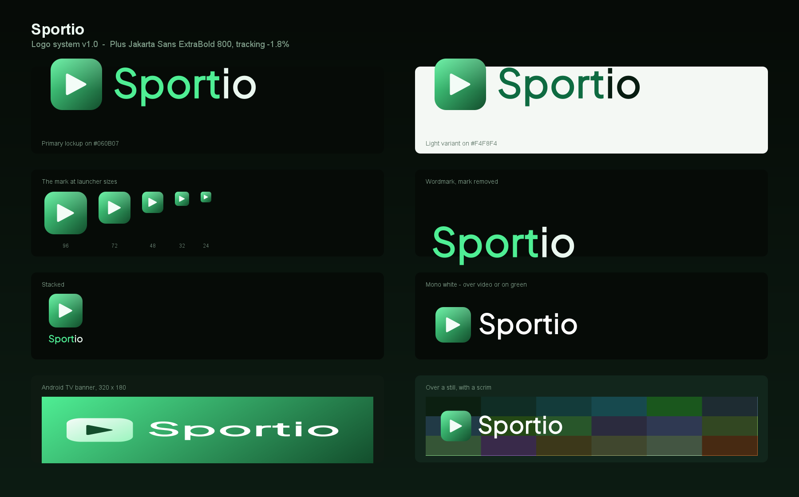

# Sportio — Brand

Alles, was **sichtbar** ist, steht hier: Logo, Farbe, Schrift, Text, Ton, Layout, Motion,
Icons, Sport-Sprachwelt und Barrierefreiheit. Vorgaben für die TV-Version des Players, aber
die Logo-Assets, die Farbtokens und die Tonalität gelten genauso für eine Phone-/Tablet-App
oder das Store-Listing.

> **Startpunkt:** [`BRAND_GUIDE_SPORTIO.md`](./BRAND_GUIDE_SPORTIO.md) — das verbindliche
> Referenzdokument. Alles andere hier ist Material dazu oder Maschinenlesbares.

---

## Wohin zuerst

| Ich will … | Lies |
|---|---|
| Das Logo korrekt einsetzen | [§2 Logo & Wortmarke](./BRAND_GUIDE_SPORTIO.md#2-logo--wortmarke) |
| Eine Farbe auswählen | [§5 Farbe](./BRAND_GUIDE_SPORTIO.md#5-farbe) · [Tokens als JSON](./sportio.tokens.json) |
| Text schreiben oder prüfen | [§3 Ton](./BRAND_GUIDE_SPORTIO.md#3-ton--stimme) · [§4 Text & Redaktion](./BRAND_GUIDE_SPORTIO.md#4-text--redaktion) |
| Einen Screen bauen | [§7 Layout](./BRAND_GUIDE_SPORTIO.md#7-layout-raum--form) · [§10 Komponenten](./BRAND_GUIDE_SPORTIO.md#10-komponenten) |
| Den Sport-Hub gestalten | [§11 Sport-Spezifika](./BRAND_GUIDE_SPORTIO.md#11-sport-spezifika) |
| Prüfen, ob es barrierefrei ist | [§12](./BRAND_GUIDE_SPORTIO.md#12-barrierefreiheit) |
| Die App umfärben | [§13 Implementierung](./BRAND_GUIDE_SPORTIO.md#13-implementierung-in-der-app) |
| Etwas ausliefern | [§14 Checklisten](./BRAND_GUIDE_SPORTIO.md#14-checklisten) |
| Neues Logo-Asset bauen | [§2.8 Dateien](./BRAND_GUIDE_SPORTIO.md#28-dateien) + `tools/brand/SportioLogo.java` |

---

## Dateien

### Dokumentation
| Datei | Inhalt |
|---|---|
| `BRAND_GUIDE_SPORTIO.md` | Der Guide. 14 Kapitel + 3 Anhänge, verbindlich. |
| `sportio.tokens.json` | Alle Werte maschinenlesbar. Figma/Style Dictionary/Web. |
| `SportioPalette.kt` | Kotlin-Drop-in für `core/theme/`. M3 + Stage + Semantik + Teamfarben. |

### Logo-Assets (`assets/`)
| Ordner | Inhalt |
|---|---|
| `svg/` | 14 Vektoren — Lockup, Wortmarke, Marke, Banner, je mit Dark/Light/Mono |
| `png/` | 11 Raster, inkl. `logo-board.png` als Übersichtsblatt |
| `android/` | `sportio_mark.xml`, `sportio_wordmark.xml` (VectorDrawable) |

### Werkzeuge (`tools/brand/`)
| Datei | Zweck | Endet mit |
|---|---|---|
| `SportioLogo.java` | Erzeugt alle Logo-Assets aus der App-Font | Exit 1, wenn ein PNG beschnitten ist |
| `audit_brand.py` | Guide ↔ Tokens ↔ Kotlin, Rampe aus der Farbmaths | Exit 1 bei Drift |
| `check_contrast.py` | Stage-Neutralen gegen Seite **und** gehobene Fläche | Exit 1 bei Kontrastfehlern |
| `check_svg_bounds.py` | Logo-SVGs gegen ihren `viewBox` | Exit 1, wenn Grafik herausragt |

Alle brauchen nur das portable JDK bzw. Python aus `tools-setup/`. Keine Fremdbibliotheken,
kein Netz.

---

## Die Marke in fünf Zeilen

- **Was:** ein TV-Sports-Player. Der Nutzer bringt seine Quellen mit; Sportio verbindet
  den linearen Kanal mit dem Sport-Hub.
- **Kern:** „Ich sehe das Spiel, und ich finde den Sender, der es zeigt."
- **Ton:** kompakt, sachlich, ruhig. Fernsehbarbeit vor Witz.
- **Farbe:** Grün, Hue 146 — der Rasen unter Flutlicht. Nicht Petrol wie Upstream.
- **Schrift:** Plus Jakarta Sans, ExtraBold 800 im Logo.

---

## Warum es zwei Farbschichten gibt

Material 3 kennt keine Rolle `dim`, `body` oder `navText`. Die Stage-Oberfläche braucht sie
trotzdem. Sie stehen deshalb in `SportioPalette.Stage`, nicht in der M3-Palette — eine
M3-konforme Palette mit erfundenen Rollen würde verschleiern, woher die Werte kommen.

| Schicht | Datei im Code | Wofür |
|---|---|---|
| M3 | `SportioPalette.kt` → Core `Palette.kt` | Flächen, Text, Akzent, Semantik |
| Stage | `SportioPalette.Stage` → App `StageTokens.kt` | `dim`, `body`, `navText`, Keycaps |

Details in [§5.5](./BRAND_GUIDE_SPORTIO.md#55-die-stage-schicht).

---

## Vier Light-Farben weichen vom Upstream ab

Geprüft, nicht geschätzt. Upstreams Werte erreichen auf Sportios hellen Flächen nur
3,4–4,5:1:

| Rolle | Upstream | Auf Sportios Light | Sportio | Neu |
|---|---|---|---|---|
| `ok` | `#2B8A3E` | 4,08:1 | `#1B743C` | 5,39:1 |
| `warn` | `#9A5A08` | 4,28:1 | `#8B5904` | 5,52:1 |
| `danger` | `#D23B2E` | 4,45:1 | `#BD2C1F` | 5,49:1 |
| `ratingStar` | `#FFCC4D` | **1,40:1** | `#906A09` | 4,58:1 |

Der Upstream-Kommentar behauptet, der Rating-Chip bleibe „in light unverändert". Bei
`#FFCC4D` auf `#F4F7F5` ist er **kein gültiges Text-Gold**. Begründung in
[§5.5](./BRAND_GUIDE_SPORTIO.md#55-die-stage-schicht).

---

## Offen

- [ ] Palette in `core/theme/Palette.kt` einbauen und `AccentColor` auf `SPORTIO` umstellen (§13.2)
- [ ] `assets/android/*.xml` nach `res/drawable` kopieren, `BrandLockup.kt` / `AppIcon.kt` umstellen
- [ ] `StageTokens.kt` auf `SportioPalette.Stage` umstellen, inkl. der vier Light-Abweichungen
- [ ] `SportsScreen.kt` auf `SportioPalette.Team` statt Roh-`colorHex` umstellen